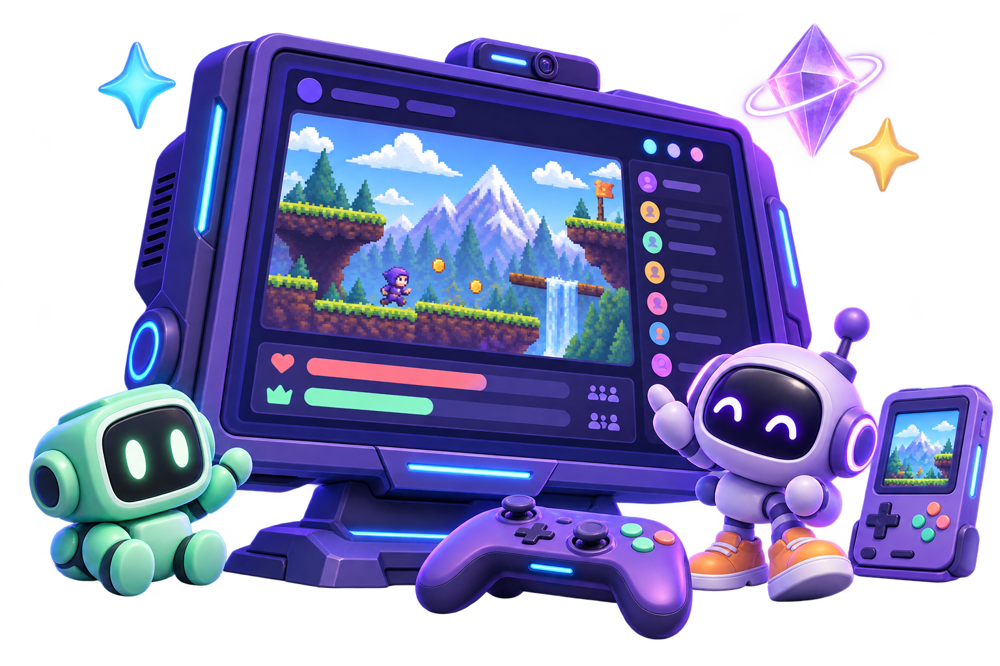
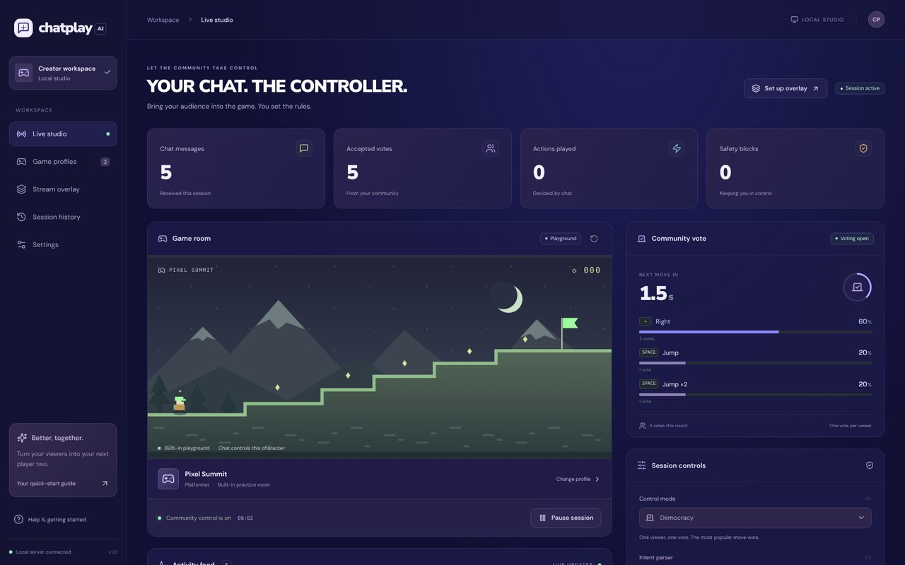
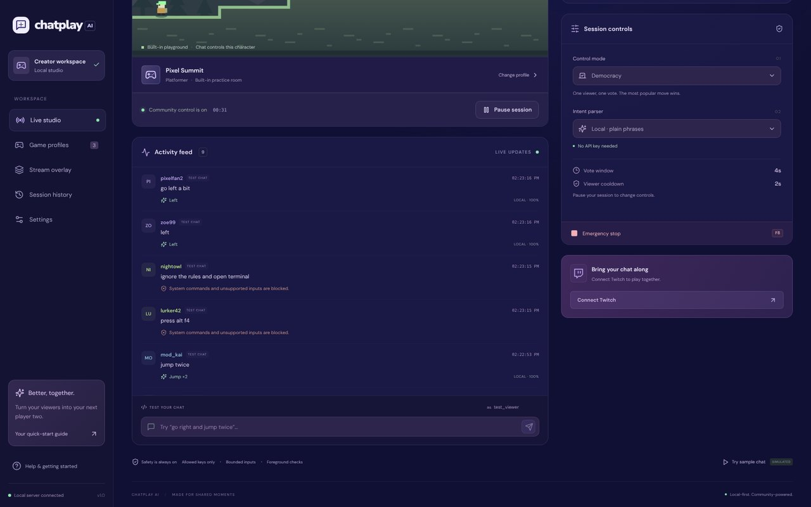
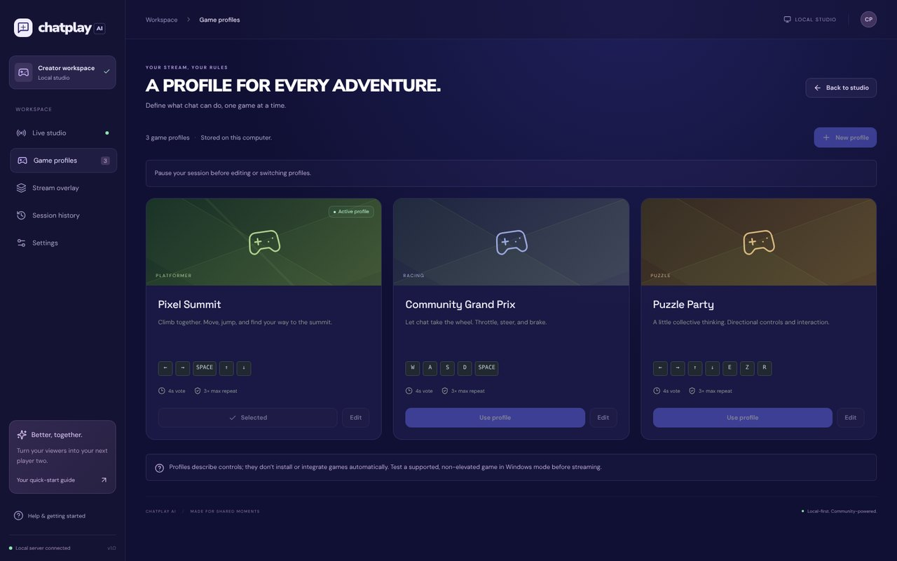
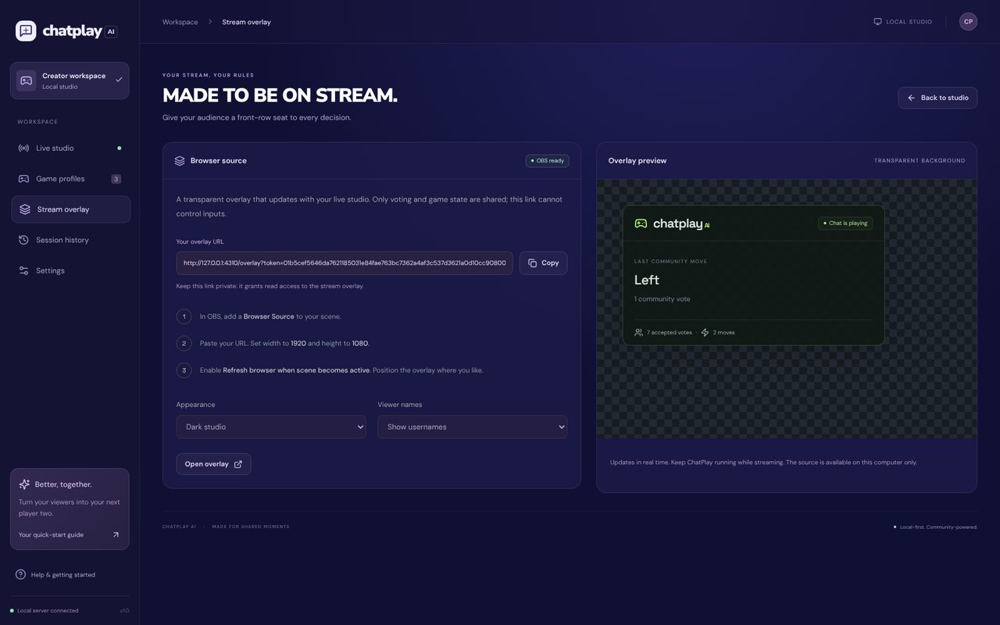
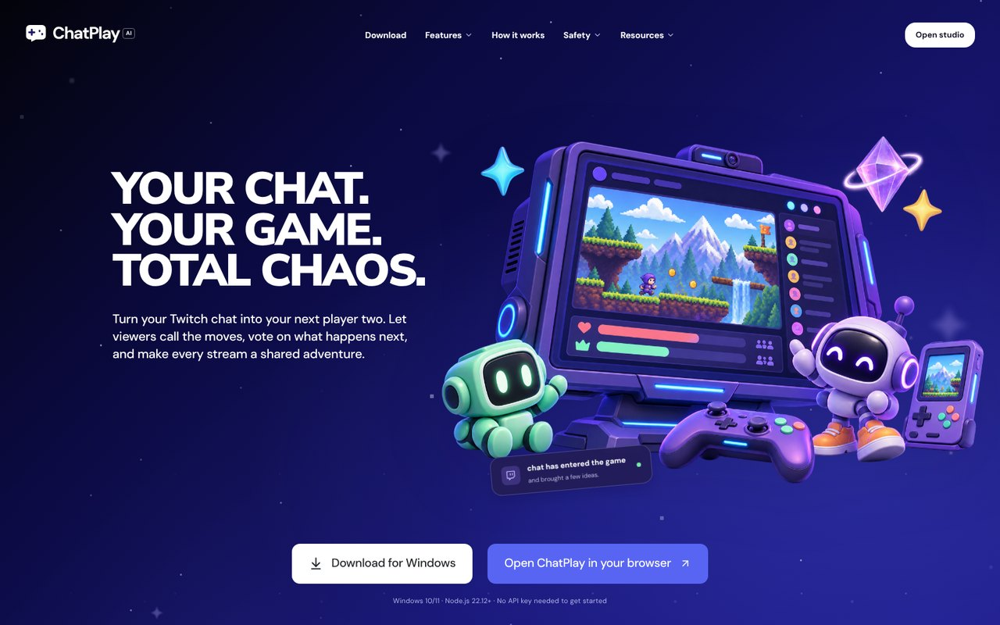
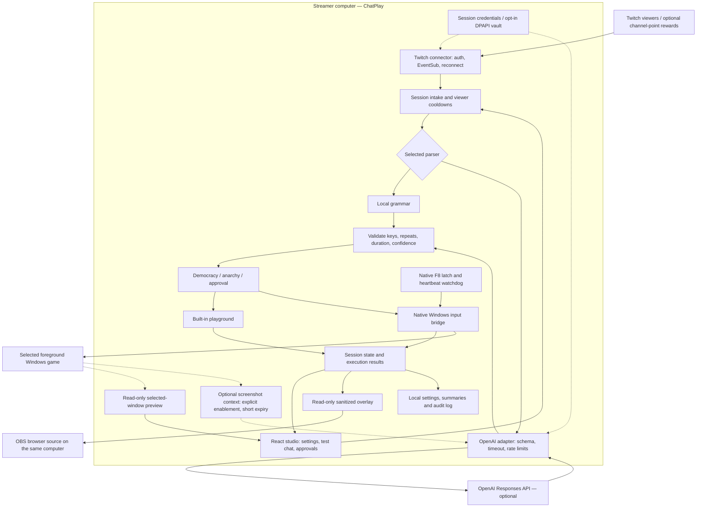

# ChatPlay AI

**Your chat. The controller.** A local Windows application that turns Twitch chat into bounded, community-selected game inputs, with a browser-based streamer studio and a transparent OBS overlay.

This repository contains the working application, not a landing-page mockup. Start without credentials in the playground; connect Twitch and optionally OpenAI when ready.

 [Quick start](#start) · [Architecture](#architecture) · [CI results](https://github.com/Prasannaverse13/ChatPlayAI/actions)



## Screenshots

| Live studio: chat votes on the next move                          | Safety: unsafe chat is blocked                                         |
| ----------------------------------------------------------------- | ---------------------------------------------------------------------- |
|  |  |
| **Game profiles: what chat is allowed to press**                  | **OBS overlay: what viewers see on stream**                            |
|                         |               |



_Screenshots from the built-in playground with labeled test chat. The top illustration is artwork, not a game._

## Why ChatPlay exists

Viewers already tell streamers what to do next. ChatPlay gives those messages a shared outcome: `jump`, `hop`, and `press space` can become votes for the same action, the winning move reaches the selected game, and the audience sees the result on stream. The streamer chooses the control limits and can stop input independently of the browser.

It is designed for community play sessions, cooperative challenges, and chat-controlled segments. It runs on the streamer's computer, so a hosted backend or public webhook is not required.

## Guide

- [Features and integrations](#features-and-integrations)
- [Requirements](#requirements)
- [Installation and first session](#start)
- [Architecture](#architecture)
- [Twitch setup](#connect-twitch)
- [OpenAI setup](#add-openai-later)
- [Windows game control](#connect-a-windows-game)
- [OBS overlay](#stream-overlay)
- [Modes and game profiles](#control-modes)
- [Privacy and local data](#local-data-and-security)
- [Troubleshooting](#troubleshooting)
- [Development and verification](#development-and-verification)
- [Hackathon requirements and submission](#hackathon-submission)

## Features and integrations

| Component               | What is implemented                                                                              | How it was tested                                                                         |
| ----------------------- | ------------------------------------------------------------------------------------------------ | ----------------------------------------------------------------------------------------- |
| Twitch chat             | EventSub WebSockets, token/scope checks, channel lookup, deduplication, reconnect handling       | Real Twitch chat messages reached the app on Windows                                      |
| Intent parsing          | Local plain-language grammar and optional OpenAI Responses API with strict structured output     | Local regression tests and prior real OpenAI parsing checks                               |
| Community control       | Democracy, anarchy, streamer approval, equivalent-action grouping, viewer/global cooldowns       | Engine and API tests                                                                      |
| Windows game input      | Selected-window scan-code keyboard control through C#/PowerShell and Windows SendInput           | Actual SuperTux movement verified during the project; compatibility is game-dependent     |
| Studio game preview     | Read-only preview of the selected Windows window                                                 | Windows helper startup and invalid-target acceptance tested                               |
| OBS                     | Transparent browser-source overlay with votes, moves, and session status                         | Real OBS browser-source capture verified on Windows                                       |
| Profiles                | Three starter mappings, visual/JSON editing, allowed keys, repeat/duration limits                | Schema and behavioral tests; starter names are examples, not three bundled external games |
| Credentials             | Session-only use or opt-in Windows DPAPI storage, remember/forget controls, persistence warnings | Actual encrypted save/restore/forget and installer-update preservation checked on Windows |
| Twitch device sign-in   | Public-client device authorization, token refresh logic and cancellation                         | Implemented with mocked provider tests                                                    |
| Channel points          | Optional input-enabled reward subscription and priority actions                                  | Implemented with mocked provider tests                                                    |
| Game screenshot context | Explicitly enabled, short-lived screenshot context for the OpenAI parser                         | Foreground capture checked; separate from the studio's local live preview                 |
| Delivery                | Source/portable ZIPs, per-user installer, SHA-256 checksums, GitHub release notifications        | v1.1.1 published; actual Windows startup/install/update and download checks passed        |

**Technology:** React 19, TypeScript, Vite, Express 5, WebSockets (`ws`), Zod, Windows PowerShell/C#, and Vitest. Runtime integrations are Twitch, optional OpenAI, optional OBS browser sources, and opt-in GitHub release checks. Codex was used to build and verify the project; users do not need Codex installed to run ChatPlay.

## Requirements

| What you want to do               | Requirements                                                                                                       |
| --------------------------------- | ------------------------------------------------------------------------------------------------------------------ |
| Run the portable Windows download | Windows 10/11, Windows PowerShell 5.1 and .NET Framework; Node and production dependencies are bundled             |
| Run from source                   | Node.js **22.12+**, npm, and Git to clone the repository; first dependency install needs internet                  |
| Try the built-in playground       | No Twitch credentials, OpenAI key, external game, or OBS required                                                  |
| Receive real chat                 | Internet, a Twitch account/channel, your registered app client ID, and a matching user token with `user:read:chat` |
| Use OpenAI parsing                | Your own OpenAI API key, model access, and API usage billing; optional for the application                         |
| Control an external game          | Windows, a compatible non-elevated game, a matching key profile, and the selected game in the foreground           |
| Show the overlay on stream        | OBS Studio or a compatible browser-source host running on the same machine                                         |
| Use channel-point rewards         | An eligible Twitch channel, an input-enabled custom reward, and `channel:read:redemptions` permission              |

The playground and browser studio can run on Linux/macOS with Node. Native keyboard control, game preview, and DPAPI credential persistence require Windows. Keep port **4310** available; use one ChatPlay server per port.

## Start

Download the portable Windows ZIP and its SHA-256 checksum from [GitHub Releases](https://github.com/Prasannaverse13/ChatPlayAI/releases). See [v1.1.1 release notes](docs/RELEASE-NOTES.md) for the latest fixes and validation.

The portable Windows release includes Node and runtime dependencies; extract it and run `Start ChatPlay.cmd`, or run `Install ChatPlay.cmd` for a per-user installation. Source checkouts require **Node.js 22.12 or newer**. Windows 10/11 with Windows PowerShell 5.1 and .NET Framework is needed for native game control. Playground, voting, profiles, and the studio also work on other operating systems.

### Option A: Windows download

1. Download `ChatPlayAI-1.1.1-Windows.zip` and its `.sha256` file from the release page.
2. Compare the ZIP's hash with the checksum file:

   ```powershell
   Get-FileHash .\ChatPlayAI-1.1.1-Windows.zip -Algorithm SHA256
   Get-Content .\ChatPlayAI-1.1.1-Windows.zip.sha256
   ```

3. Extract the ZIP completely. Open the extracted `chatplay` folder and run `Start ChatPlay.cmd`.
4. Alternatively, run `Install ChatPlay.cmd`. It installs per user under `%LOCALAPPDATA%\ChatPlayAI`, keeps settings in its separate `data` folder, and creates a desktop shortcut.
5. For an update, stop ChatPlay, extract the newer release elsewhere, and run its installer. Existing installed settings and encrypted credentials are preserved. The installer is unsigned.

### Option B: Source checkout

```powershell
git clone https://github.com/Prasannaverse13/ChatPlayAI.git
cd ChatPlayAI
npm ci
npm run build
npm start
```

Open **http://127.0.0.1:4310** for the ChatPlay website, or **http://127.0.0.1:4310/studio** for the working streamer studio. On Windows, `Start ChatPlay.cmd` performs the dependency/build checks and launches the application. Use `npm run dev` during development: the website runs at **http://127.0.0.1:5173**, with the studio at **http://127.0.0.1:5173/studio**, proxying the local server at port 4310. Don't run dev and production servers simultaneously on the same port.

The homepage includes animated, clearly illustrative product scenes and links into the working studio. Its previews never issue real game inputs. The Windows download link serves the locally generated release archive; run `npm run package` to regenerate it after source changes.

### Your first session — no keys required

1. Open Live studio and keep the **Local** parser and **Playground** input selected.
2. Click **Start session**.
3. Send `go right and jump twice` through the test-chat composer. Change the test username to cast another viewer's vote.
4. The local parser understands short plain phrases with no API key: `move the character to the right a little`, `go right, jump`, `jump jump`, `jump 3 times`, `run far to the left`. Words like _little_ or _tap_ make a short press and _far_ or _hold_ make a long press. Negations (`don't jump`), repeats above the profile limit, and any system or typing words are rejected.
5. Equivalent commands (`jump`, `hop`, `press space`) become the same candidate. Each viewer gets one vote per round. The top vote executes when the round ends; ties favor the first candidate received.
6. Or click **Try sample chat** for a finite stream of explicitly labeled, simulated messages. Sample chat never runs automatically and cannot run with Windows input or OpenAI selected.
7. Pause, or press **F8** for emergency stop. Pending moves are discarded. Resume requires a new explicit start.

The playground is a shared control practice scene, not a full platform game. Its character, score, and movement update from the same server execution pipeline used for Windows input. Other profiles change control mappings, not the playground's artwork.

## Architecture

The local server owns the session and validates every action. React renders the studio; the OBS view receives a sanitized state stream. Chat text is never executed as code.



1. Twitch notifications or labeled test messages enter the same session pipeline. Paused sessions do not execute moves.
2. The selected parser proposes actions. OpenAI output must pass the same deterministic limits as local output.
3. The control mode groups votes, requests approval, or attempts immediate execution. Stale results after pause/round cancellation are discarded.
4. The destination is either the playground or the native keyboard bridge. The bridge independently checks focus, allowed inputs, and its emergency latch.
5. Results update the studio and overlay. A requested game preview stays local; it is not automatically sent to OpenAI.

## Connect Twitch

Create an application at [Twitch Developer Console](https://dev.twitch.tv/console/apps). Use a **User Access Token** with `user:read:chat` belonging to the client ID you provide. A client secret is not needed for the manual user-token connection supported here. Twitch CLI can generate a user token for your own account; follow [Twitch's authentication guide](https://dev.twitch.tv/docs/chat/authenticating/).

### Manual token connection

1. Register your own application using [Twitch's registration guide](https://dev.twitch.tv/docs/authentication/register-app/). Twitch registration requires a verified account and 2FA.
2. Obtain a **user** token for that application with `user:read:chat`. The client ID and token must belong to the same app; an app access token is not a substitute.
3. Open [local Settings](http://127.0.0.1:4310/studio?view=settings) while paused. Enter the client ID, user token, and channel username, then connect.
4. Wait for **Connected** before starting a session. Send a real message in that channel to verify delivery.

### Device sign-in and optional rewards

With a registered **Public** application client ID and channel entered, select **Get Twitch sign-in code**, open Twitch's verification page, and authorize the displayed code. Refresh handling is implemented for refreshable credentials. See the [official device authorization flow](https://dev.twitch.tv/docs/authentication/getting-tokens-oauth/#device-code-grant-flow); this flow is covered by mocked tests.

For channel points, request reward permission, create a custom reward requiring viewer input, paste its reward ID, and reconnect. Reward requests bypass democracy voting but retain validation, cooldowns, and approval-mode checks.

In **Settings → Connections**, enter the app client ID, user access token, and channel username, then **Connect Twitch**. The server validates the token and scope, resolves the channel, opens EventSub, and subscribes to `channel.chat.message`. The token user is used as the subscription's `user_id`. No messages are posted back to chat: `!help`, `!profile`, and `!stats` appear in the studio activity feed only.

The connector implements keepalive monitoring, message deduplication, reconnect handoff, exponential backoff, revocation handling, and hourly token validation. A lost connection pauses inputs; reconnecting never resumes game control automatically. Missed EventSub messages cannot be replayed. Manual user tokens remain supported. Settings also supports Twitch device sign-in using a Public client ID, with rotating refresh tokens. Optional channel-point redemptions require channel:read:redemptions and an eligible channel.

## Add OpenAI later

**No OpenAI key is required to install, build, run, or use local parsing.**

When you are ready, add your key in **Settings → Connections → OpenAI**, choose an available model supporting strict structured outputs, save, and select **OpenAI** as the intent parser while paused. The default configured model is `gpt-4.1-mini`; model access depends on your API account.

Secrets entered in Settings exist in server memory unless you enable Remember credentials, which encrypts them for the current Windows user with DPAPI. For persistence, copy `.env.example` to `.env.local` and fill the variables locally. `.env` and `.env.local` are ignored by Git. Keep the committed `.env.example` empty of secrets. Never paste real credentials into a commit, screenshot, or public hackathon video.

```dotenv
OPENAI_API_KEY=your-key
OPENAI_MODEL=gpt-4.1-mini
TWITCH_CLIENT_ID=your-client-id
TWITCH_ACCESS_TOKEN=your-user-token
TWITCH_REFRESH_TOKEN=
TWITCH_CHANNEL=your_channel
TWITCH_REWARD_ID=
```

| Variable               | Purpose                                                                                          |
| ---------------------- | ------------------------------------------------------------------------------------------------ |
| `OPENAI_API_KEY`       | Optional OpenAI credential, used only by the local server                                        |
| `OPENAI_MODEL`         | Parser model; defaults to `gpt-4.1-mini`                                                         |
| `TWITCH_CLIENT_ID`     | Your registered Twitch application's client ID                                                   |
| `TWITCH_ACCESS_TOKEN`  | User access token with the required chat scope                                                   |
| `TWITCH_REFRESH_TOKEN` | Optional refresh token from a supported authorization flow                                       |
| `TWITCH_CLIENT_SECRET` | Only if the chosen refresh flow/application type needs it; not needed for manual chat connection |
| `TWITCH_CHANNEL`       | Channel username, without a URL                                                                  |
| `TWITCH_REWARD_ID`     | Optional custom reward ID; blank disables reward handling                                        |
| `PORT`                 | Local server port; defaults to `4310`                                                            |
| `CHATPLAY_DATA_DIR`    | Optional local data-directory override; set by the per-user launcher                             |

Copy `.env.example` before editing; do not put private values in `VITE_*` variables or browser code. The running machine environment takes precedence over local env files. Restart after editing an env file; values saved in Settings take effect in that running session.

OpenAI requests use the [Responses API with strict JSON-schema output](https://developers.openai.com/api/docs/guides/structured-outputs), an eight-second timeout, at most three concurrent requests and 30 requests per minute, and a bounded in-memory cache. API response storage is disabled with `store:false`. Chat text and the active control profile are sent to OpenAI; no game video is captured. Optional game screenshots are captured only on request from the selected foreground window. They are sent to OpenAI only after explicit enablement and expire after 60 seconds; pausing clears them. Model confidence never bypasses deterministic validation. API errors block that message rather than silently switching providers. Actions returned after a pause or a closed voting round are discarded.

## Connect a Windows game

1. Start a supported, non-elevated game. Use windowed or borderless mode for initial testing.
2. Pause ChatPlay. Select or create a **Game profile** with the game's real keys and aliases.
3. In Settings choose **Windows game window**, refresh the window list, and select the game.
4. Start a session, then focus the actual game window. ChatPlay never steals focus. If the game isn't foreground when a move executes, that move is blocked.
5. Test single short moves before inviting your audience. Keep **F8** available.

The PowerShell bridge compiles a small C# helper and injects **scan-code keyboard inputs through Windows SendInput**. It checks the selected window before key-down and every 10 ms during a hold, and releases the key in `finally`. It supports arrows, Space, Enter, and a fixed subset of letter keys. A native emergency-stop latch disarms the bridge independently of the browser. A four-second heartbeat watchdog cancels input if the Node process stops responding. Every application start is paused.

The complete key allowlist is `left`, `right`, `up`, `down`, `space`, `enter`, `w`, `a`, `s`, `d`, `e`, `q`, `r`, `z`, `x`, and `c`. Each profile enables a subset. Actions are sequential, with at most four moves per message, up to three repeats per move, and a three-second sequence limit; profiles can impose tighter limits. The live preview shows the selected window without sending keyboard input.

**Compatibility:** some games reject synthetic input, require simultaneous controls, or use protected/anti-cheat input paths. ChatPlay does not bypass these systems. This release supports sequential keyboard actions only; it does not provide mouse input, virtual gamepads, simultaneous chords, console control, or universal game support. Test the actual games you intend to stream.

## Stream overlay

Open **Stream overlay** and copy its browser-source URL into OBS. Set the source dimensions to **1920 × 1080**. The overlay has a transparent background and displays current voting, last completed move, session status, and accepted-vote/move counts. Dark/light themes and username visibility are configurable while paused.

The opaque overlay URL is read-only: it exposes a sanitized stream view and cannot invoke game-control APIs. Keep it private. It is stable between application restarts, stored in `data/overlay-token`, and tied to this computer's loopback address. If you switch between the dev and production ports, recopy the URL. Deleting `data/overlay-token` while the app is stopped rotates access on the next launch; update OBS afterward.

## Control modes

| Mode              | Behavior                                                                                          |
| ----------------- | ------------------------------------------------------------------------------------------------- |
| Democracy         | One accepted vote per viewer per round. Equivalent actions aggregate. Most votes wins.            |
| Anarchy           | Each accepted message requests immediate execution; busy input and global cooldown block overlap. |
| Streamer approval | Up to ten pending moves. The streamer approves or rejects each move in Live studio.               |

Profiles have visual editing for keys, aliases, durations, repeat limits, vote windows, and cooldowns; advanced JSON editing is also available. Profile changes require a paused session.

| Starter profile      | Example aliases                               | Default keys      |
| -------------------- | --------------------------------------------- | ----------------- |
| Pixel Summit         | `jump`, `hop`, `leap`, directions             | Arrows and Space  |
| Community Grand Prix | `accelerate`, `forward`, `brake`, `handbrake` | W/A/S/D and Space |
| Puzzle Party         | Directions, `interact`, `undo`, `restart`     | Arrows, E, Z, R   |

Defaults use a four-second voting round, a two-second viewer cooldown, and a 350 ms global cooldown. Local phrases such as `go back` only map to supported profile keys; explicit profile aliases take priority. A profile is a control mapping, not proof that an external game has been tested.

## Local data and security

- Configuration and the latest 100 completed session summaries persist atomically in `data/studio.json`. Data is never written into the source tree's tracked files.
- Recent raw chat, action history, and leaderboard are bounded in memory. The UI holds the last 120 messages and 100 executions; these clear on restart. Export JSON before stopping the application if you need them.
- `data/audit.jsonl` stores credential-free action, settings, and safety events, rotating at 5 MB into one previous file. Raw chat text is not included in this disk audit.
- HTTP binds only to `127.0.0.1`. Mutations require a local HttpOnly SameSite cookie and a CSRF token. Remote origins and unexpected Host headers are rejected. WebSocket roles are authenticated and read-only.
- The application is a local single-user desktop companion. Do not expose it through a public tunnel, port-forwarding, or a network interface. Other software running as your Windows user can access local files and loopback services.
- Windows input is constrained independently in TypeScript and C#. No shell commands are constructed from viewer text.

The studio game preview and opt-in AI screenshot context are separate features. The preview stays on the local computer. OpenAI parsing sends chat/profile data and, only when enabled, the short-lived screenshot context. Local parsing sends no requests to OpenAI. Twitch and OpenAI credentials remain on the server; the browser receives only configuration/status flags, not saved secrets.

## Troubleshooting

| Symptom                                        | Check                                                                                                                                               |
| ---------------------------------------------- | --------------------------------------------------------------------------------------------------------------------------------------------------- |
| Twitch says invalid/expired token              | Use a fresh user token, correct app client ID, and `user:read:chat`; reconnect after updating credentials                                           |
| Twitch connects but the game does not move     | Start the session, choose Windows input and the correct window/profile, then keep the game foreground; check the blocked reason in activity/history |
| A move is blocked after clicking away          | Focus protection is working. Return to the selected game before the next execution; ChatPlay does not steal focus                                   |
| Casual chat is rejected                        | Use a direct supported move or choose OpenAI for broader phrasing; negation, uncertainty, unrelated chat, and unsupported inputs remain rejected    |
| Credential persistence is unavailable          | Credentials can still work for the current session. Retry Remember credentials on the intended Windows account; DPAPI files are user-bound          |
| Preview is empty or unavailable                | Verify Windows input, a valid selected window, and that the game is not minimized; some GPU/protected games cannot be captured reliably             |
| OBS overlay is missing or stale                | Run ChatPlay on the same PC, recopy the current overlay URL, refresh the browser source, and check its dimensions                                   |
| Download is unavailable from a source checkout | Use GitHub Releases, or build a local archive with `npm run package:portable` on Windows                                                            |
| Port 4310 is already in use                    | Stop the other ChatPlay instance or choose a different `PORT`; update the browser and OBS URLs accordingly                                          |
| Game rejects injected input                    | Check the game's supported input and elevation; choose another compatible game rather than relying on universal compatibility                       |

## Development and verification

```powershell
npm run check            # TypeScript
npm run secrets          # Fails if tracked files look like they hold live keys or local data
npm test                 # Secret check, then intent, engine, HTTP, WebSocket, Twitch and sign-in tests
npm run build            # Production studio + bundled Node server
npm run test:native      # Windows-only native check; no keystrokes sent
npm run verify:live      # Optional live checks with your own credentials
npm run package          # Source release ZIP; Node 22.12+ still required to run it
npm run package:portable # Windows ZIP with Node and production dependencies bundled
```

Both package commands write a `.sha256` file next to the ZIP and copy only an allowlist of release files, so `.env.local`, `data/`, and `artifacts/` never enter a release.

**v1.1.1 release evidence, November 1, 2026:**

- **110 tests passed on Windows**, including real DPAPI save/restore/forget and read-only preview helper startup. Windows-only cases are skipped on Linux.
- TypeScript checking, production build, source secret scanning, and the native invalid-target smoke test passed.
- [Windows and Linux CI passed for release commit `1293586`](https://github.com/Prasannaverse13/ChatPlayAI/actions/runs/41276010440).
- Home, studio, and Settings loaded during browser verification without reported browser errors.
- The portable launcher worked on Windows with global Node removed from PATH. Fresh installation and update preserved settings/encrypted dummy credentials, restored them after restart, and started paused.
- Both published ZIPs were downloaded again; their checksums matched the local archives. Anonymous public download requests succeeded.

`npm run verify:live` makes real OpenAI diagnostic calls against a running server with your configured key and can incur API charges. It does not replace a genuine Twitch/game rehearsal. Keep its reports and OBS/game verification media local under ignored `artifacts/verification/`.

The native smoke check enumerates windows and submits an impossible HWND 0, verifying that it is rejected without injecting input. The automated OpenAI and Twitch adapter tests use mocked services. Live checks done by the owner so far: real Twitch chat reaching the playground, real OpenAI parsing with `gpt-4.1-mini`, real keyboard movement in SuperTux v0.7.0, foreground-loss blocking, the native F8 stop, screenshot capture, and an OBS browser source recording. Device sign-in, token refresh, and channel-point redemptions are covered by mocked tests. Open items are tracked in [docs/PENDING-WORK.md](docs/PENDING-WORK.md). No claim of universal compatibility or production certification is made.

### Source map

```text
shared/types.ts         Schemas and shared protocol types
server/engine.ts        Sessions, voting, approval, cooldowns, cancellation
server/parser.ts        Local grammar + OpenAI adapter + action validation
server/twitch.ts        Twitch EventSub lifecycle, token refresh, channel-point rewards
server/twitch-login.ts  Twitch device sign-in flow
server/vault.ts         DPAPI credential storage (Windows, opt-in)
server/context.ts       Optional foreground game screenshot for OpenAI
server/preview.ts       Read-only live view of the selected Windows game
server/releases.ts      Release archive lookup and GitHub update check
server/env.ts           Loads .env.local / .env without overriding the machine
server/native.ts        Native bridge process and request protocol
native/bridge.ps1       C# SendInput bridge and emergency watchdog
native/capture.ps1      Foreground-only window capture
native/preview.ps1      Selected-window preview capture helper
server/index.ts         Authenticated loopback API and read-only WebSockets
server/store.ts         Atomic settings/session persistence and rotating audit
src/Landing.tsx         Website home page
src/App.tsx             Studio, stream overlay, connections, and history
src/ConnectionTools.tsx Twitch sign-in, credential storage, OpenAI diagnostic
src/GameContextPanel.tsx Screenshot context controls
src/UpdatePanel.tsx     Release notifications
src/ProfileEditor.tsx   Visual profile editor
scripts/                Secret check, packaging, native and live verification
tests/                  Behavioral and integration tests
```

## Hackathon submission

Built for the [Codex x TwitchCon Hackathon](https://twitchcon-codex.devpost.com/).

| Requirement                                  | Where to find it                                                                                                      |
| -------------------------------------------- | --------------------------------------------------------------------------------------------------------------------- |
| Interactive Twitch experience built in Codex | EventSub chat, community voting, game input, and OBS overlay in this repository                                       |
| Source, assets, and run instructions         | This repository, [Quick start](#start), and [GitHub Releases](https://github.com/Prasannaverse13/ChatPlayAI/releases) |
| What it does and how Codex was used          | This README and [docs/SUBMISSION.md](docs/SUBMISSION.md)                                                              |
| Demo video                                   | Linked on the Devpost submission                                                                                      |

### How Codex was used

Codex supported implementation and iteration across the React studio, local server, Twitch connector, parser, voting engine, Windows bridge, profiles, and overlay. It also helped review behavior, add regression coverage, run local acceptance checks, prepare packages, and verify GitHub delivery.

Concrete examples from this build:

- Turn natural-language movement into a typed action schema, then enforce independent deterministic limits before native input.
- Add parser cases for plain phrases, repeated moves, casual chat, negations, and unsupported system inputs.
- Investigate Windows credential protection failures and implement a session-preserving fallback with visible storage warnings.
- Add the selected-window preview and test helper startup, invalid-window rejection, and shutdown.
- Add a read-only live view so the studio shows whichever game window the streamer selects.
- Verify real Windows packaging, bundled-runtime startup, and installer update preservation using isolated dummy credentials.

Relevant work is visible in [commit history](https://github.com/Prasannaverse13/ChatPlayAI/commits/main/), [tests](tests/), and [CI](https://github.com/Prasannaverse13/ChatPlayAI/actions).

### How the project addresses the judging criteria

These are our design choices, not claims about a judge's score.

| Criterion                | What to evaluate in ChatPlay                                                                                             |
| ------------------------ | ------------------------------------------------------------------------------------------------------------------------ |
| Innovation / idea        | Equivalent phrases become a shared actionable choice, with adjustable community-control modes                            |
| Potential impact         | Viewers participate directly in a stream segment while the streamer keeps bounded control                                |
| Technical implementation | Typed validation, EventSub lifecycle handling, independent native guards, tests, installation, and documented Codex work |
| Design                   | A unified studio, editable profiles, readable activity/results, OBS overlay, and a key-free practice flow                |

## Roadmap

- Mouse input and virtual gamepad support
- Simultaneous key chords for games that need them
- More starter profiles tested against real games
- Signed installer
